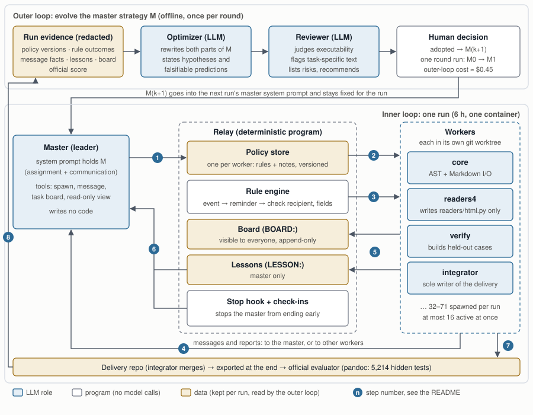
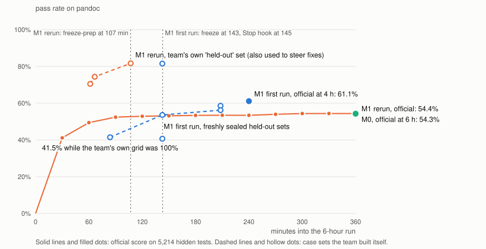
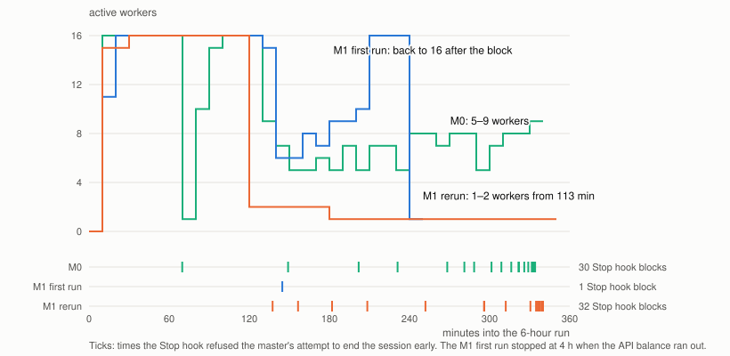

# Coevolving Agent Teams

A research prototype that asks whether the **coordination strategy of a multi-agent coding team can be
improved automatically from one run to the next**. Model weights never change; what evolves is the text a
master agent follows when it splits up work and tells its workers how to communicate.

The testbed is [ProgramBench](https://pypi.org/project/programbench/): rewrite a real program from scratch in
six hours, without internet access, against a hidden test suite. Most runs used pandoc (5,214 hidden tests);
ctags (2,258 tests) was used as a first transfer check. The team runs on the Qwen Code CLI's native team mode,
patched at runtime, with DeepSeek V4.1 Flash as the model.

**Status: concluded (October 2026).** The machinery works end to end, and one round of evolution was run.
The main finding is that run-to-run variance and the master's mid-run decisions outweigh the effect of the
strategy text. This repository holds the code, the tests and a summary of the results; the raw run records
are not included.



## How it works

There are two loops.

**Outer loop (offline, once per round).** The *master strategy* M is two pieces of text: an assignment part
(how to decompose, staff, sequence and integrate) and a communication part (what messages are for and how to
write each worker's policy). After a run, an **optimizer** model reads redacted evidence from that run and
rewrites M. An independent **reviewer** model checks that each change is executable in the harness and not
specific to the task, and lists risks. A human decides whether to adopt the candidate.

**Inner loop (one 6-hour run).** The master reads M in its system prompt, writes no code and only
coordinates. Up to 16 workers are active at once, each in its own git worktree. The numbers match the figure:

1. **Spawn.** The master writes each worker a *policy*: numbered rules
   (`WHEN <event> THEN SEND TO <party> WITH <fields>`) plus free-text notes. It can change any policy later.
2. **Inject.** On every model request, a deterministic relay appends the worker's current policy, the active
   teammates and the five newest board posts by others. This tail is not kept in the conversation history.
3. **Remind and check.** A rule engine watches git, the task board, messages and the clock; when a rule
   fires it reminds the worker and checks that the report went to the right recipient with the required fields.
4. **Message.** Workers and the master message each other natively.
5. **Write back.** Workers post to a shared, append-only **board** (`BOARD:`), leave **lessons** for the master
   (`LESSON:`), or propose changes to their own policy (`POLICY-PROPOSAL`).
6. **Master side.** The master sees policy summaries, is shown unseen lessons before its next spawn, gets a
   status check-in every 30 minutes, and a **Stop hook** refuses to let it end the session while more than
   15 minutes remain and no worker or message is still pending.
7. **Deliver.** An integrator worker merges committed work into the delivery repository; at the end it is
   exported and scored by the official evaluator.
8. **Back to the outer loop.** The score and the redacted records become the next round's evidence.

The protocol is called `agent_rules_v1`. [`docs/design_zh.md`](docs/design_zh.md) (in Chinese) describes it
in detail, with pseudocode for the relay, the rule engine, the Stop hook and the outer loop.

## Results

| Task | Run | Strategy | Hours | Official passed | Pass rate | Workers | Known cost |
|---|---|---|---:|---:|---:|---:|---:|
| pandoc | batch 1 | single agent | 6 | — | — | — | ≈ $5.5 |
| pandoc | batch 1 | M0 (hand-written) | 6 | 2829 / 5214 | 54.26% | 71 | $31.05 |
| pandoc | M1 first run | M1 (evolved) | 4 | 3185 / 5214 | 61.09% | 42 | $68.81 |
| pandoc | M1 rerun | M1 (evolved) | 6 | 2835 / 5214 | 54.37% | 32 | ≈ $25.7 |
| ctags | batch 1 | single agent | 6 | 269 / 2258 | 11.91% | — | $5.90 |
| ctags | batch 1 | M0 (hand-written) | 6 | 301 / 2258 | 13.33% | 52 | $15.61 |

- The pandoc single agent has no official score: two infinite loops in its delivered code made the official test
  branches time out.
- The M1 first run stopped at four hours when the API balance ran out.
- Both M1 runs were scored after the fact with the same official evaluation (`scripts/complete_programbench_verification.py`),
  because a container that was slow to delete had made the runner skip it.
- Costs differ partly because of DeepSeek's peak and off-peak prices.
- For orientation only: the Agensh paper reports 50.94% (128 agents) and 55.06% (1,024 agents) on the same pandoc
  task with a different model and harness. The scores are not directly comparable.

Data: [`results/data/`](results/data/). Strategy texts: [`results/strategies/M0.md`](results/strategies/M0.md) and
[`results/strategies/M1.md`](results/strategies/M1.md), which also contains the optimizer's rationale and the
reviewer's risks.





### What we learned

1. **Variance beats the strategy.** The same M1 scored 3185 in one run and 2835 in the other, a gap larger than
   M1's lead over M0 (356). All 17 inputs of the two runs were checked to be identical. With one run per
   condition, the data cannot show that M1 is better than M0.
2. **The decisive moment was the master's decision to wrap up, and it rested on the team's own measurements.**
   Both M1 masters declared a freeze with 3.6–4.2 hours left.
   - In the first run, a freshly generated held-out set passed only 40.7%. When the Stop hook refused to let the
     master end, it lifted the freeze within a minute and went back to 16 workers.
   - The rerun's only held-out set had been measured 33 times in the first 74 minutes and used to route fixes.
     It read 82% while the official score was about 53%. After every Stop hook block, the master added just a
     fix-and-check pair of workers.
   - The rerun's official curve confirms the plateau: 2732 at 90 minutes, 2756 at 120, then only 79 more
     tests in the remaining four hours.
3. **The outer loop fixed mechanics reliably and behaviour unreliably.**
   - M1's precise policy-block syntax removed a failure in which 16 of 71 workers in the M0 run started with
     empty notes; neither M1 run had one.
   - Its behavioural rules were followed almost fully in one M1 run and mostly ignored in the other. These
     rules covered owned paths in the rules, sealed held-out sets, a freeze point and a durable verifier.
4. **Worker policies hardly evolved within a run.**
   - Workers changed their own policy 2, 0 and 0 times. Instead they wrote 106, 23 and 22 lessons, and lessons
     only reach the master.
   - In two of the three runs, most workers' policies were never edited after the spawn (53 of 71, 19 of 32),
     and new workers often got near-copies of earlier workers' notes.
   - In this design, "policy evolution" mostly meant the master adjusting the division of work early in the run.
5. **On ctags the team barely beat a single agent**: 32 more tests at 2.6 times the cost.

## Repository layout

```text
agent_company/
  runtime/        one run: Qwen Code CLI and its native team mode, the relay, runtime patches, network boundary
  policy/         master strategy packages and agent_rules_v1 worker policies, board, lessons, rendering
  programbench/   task loading, clean-room inference runner, official evaluation
  evolution/      optimizer, reviewer, evidence paging, M generation
  analysis/       read-only projections of recorded runs
  deploy/         commit-pinned deployment to the experiment server and launch
  roadmap/        earlier RoadmapBench path (its task base class is still reused)
configs/stage1/   provider settings, strategy texts and run profiles
scripts/          thin command-line entry points (see scripts/README.md)
tests/            unit, integration and scripted-scenario tests (no model calls)
docs/             design notes (mostly Chinese) and the ProgramBench interface
results/          scores, strategy texts, curve data and figures
```

## Running it

The test suite needs no server, model or API key:

```bash
python -m pip install -e ".[dev]"
pytest
```

Some tests also need Node.js. A few are skipped unless local ProgramBench task data is present under `external/`.

Running real experiments needs considerably more:

- a Linux server with Docker;
- the ProgramBench task images and the `programbench` package (`pip install -e ".[programbench]"`);
- a Qwen Code 0.23.1 package and Node 22;
- a DeepSeek API key.

`scripts/launch_programbench_formal.py` deploys a pinned commit to that server over SSH, verifies it and
launches runs. Configure it with these environment variables:
- `AGENT_COMPANY_SSH_HOST`
- `AGENT_COMPANY_SSH_KEY`
- `AGENT_COMPANY_SSH_KNOWN_HOSTS`
- `AGENT_COMPANY_REMOTE_ROOT`

The API key is only ever read from `DEEPSEEK_API_KEY` and passed on stdin. `scripts/README.md` lists which
scripts call paid models.

## Limitations

- One run per condition, one main task, one model, and no ablations.
- The held-out sets are built by the team itself; they are a proxy, not the hidden tests.
- Two of the four pandoc team runs were scored after the fact, with the same evaluator, because of a cleanup
  timeout that has since been fixed.
- Earlier experiment phases (RoadmapBench, three optimisation tasks, other ProgramBench tasks) are described in
  `docs/design_zh.md` but their records are not included.

## License

MIT, see [LICENSE](LICENSE). ProgramBench, Qwen Code and DeepSeek are separate projects under their own terms;
this repository does not include their code or task data.
