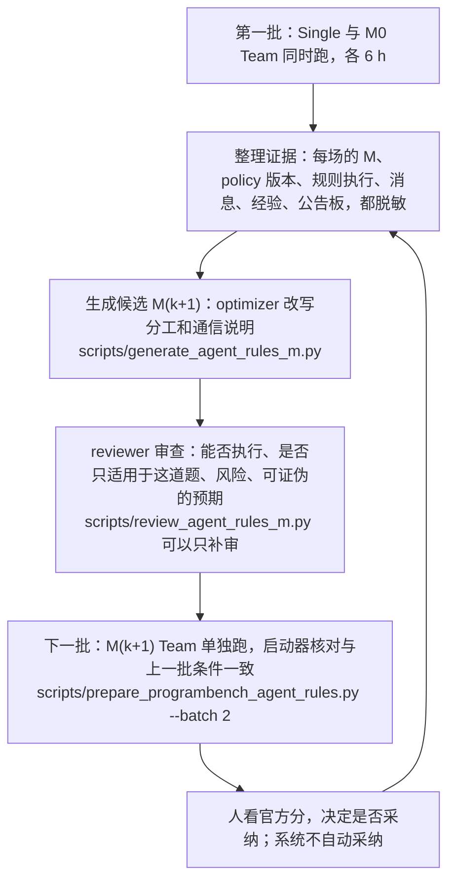
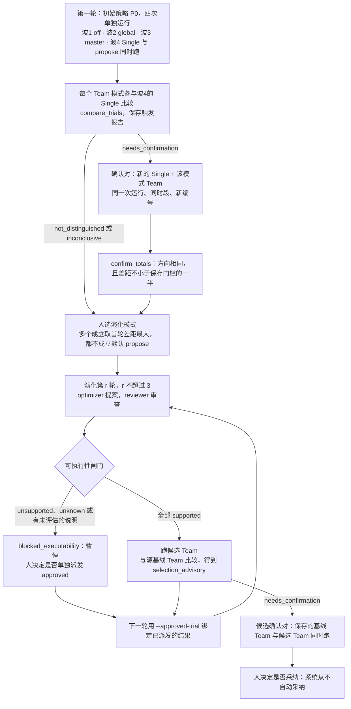
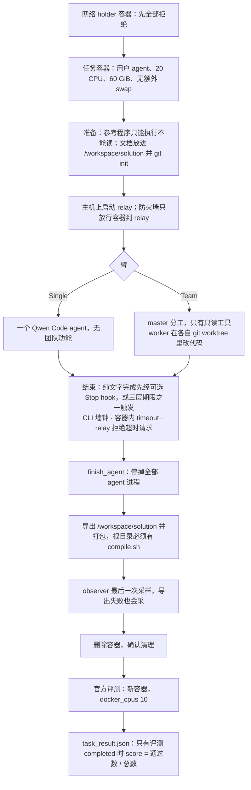
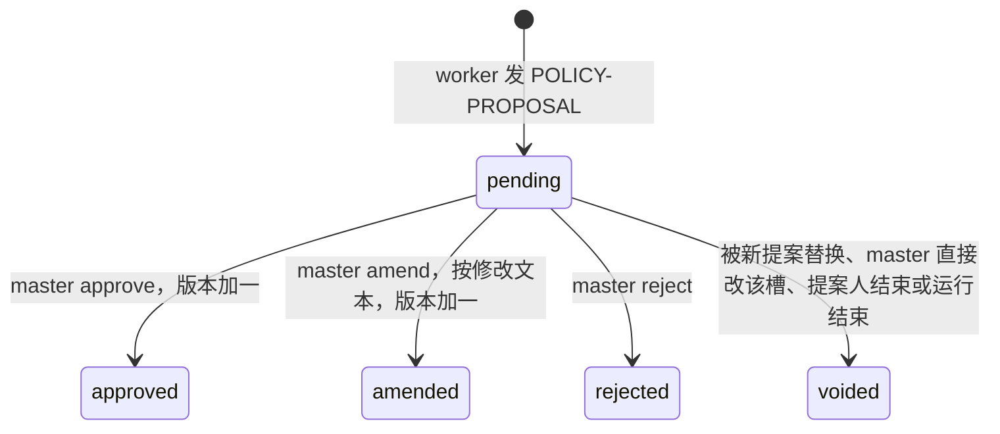

# 设计说明（项目进行中的工作文档）

> 这是项目进行到 2026-10-19 时的中文 README，原样保留作为设计说明。文中"当前""正在进行"都指当时；项目已于 2026-10-20 结束，最终结果和结论见仓库根目录的 [`README.md`](../README.md) 和 [`results/`](../results/)。文中的相对链接以仓库根目录为准。

Agent Company 是一个研究型多智能体编码系统。它固定模型、任务、资源和官方评分器，只改变团队的
组织方式，研究两个问题：多智能体团队能否胜过单个 coding agent；团队的策略能否在多次运行之间被自动改进。

当前协议 `agent_rules_v1` 有两层策略：

- **master 策略 M**：给 master 看的分工说明和通信说明。每场运行之后，由 optimizer 根据这一场的证据改写，
  reviewer 审查，得到下一版 M。
- **每个 worker 自己的 policy**：由结构化规则和自由文本 notes 组成，master 派活时写，运行中可以改。
  worker 可以提议修改自己的 policy。

团队另有两种共享记录：全队可见的公告板（board），以及只有 master 能看的经验（lesson）。机制见下文
“4. agent_rules_v1”。

项目不训练或微调模型权重。人只修可复现的框架缺陷，不手改 M，也不在提示里预设“正确答案”。
代码质量由官方或隔离的确定性评分器重新计算，不相信模型自报的分数。

当前主线是 Stage-1（2026-09 起）。此前 V5（2026-07 → 08）的实验与结果保留在文末“历史：V5”一节。

## 当前状态（2026-10-19）

- **协议**：`agent_rules_v1`（10-17 至 10-18 实施，部署代码 `f3d83ed`）。Pandoc 单题，每场 6 h，每臂 20 CPU / 80 GiB，
  Team 最多 16 名活跃 worker，check-in 每 1800 s 一次，Single 与 master 装 Stop hook。
- **第一批**（10-18 至 10-19）：Single 与 M0 Team 同时跑。
  - M0 Team 官方 2829/5214（54.26%）。
  - Single 的交付代码有两处死循环，官方评测的测试分支超时，被中止，没有官方分。
- **第一次演化**：optimizer 根据第一批的证据，从 M0 改写出 M1；reviewer 审查结论为 prefer_candidate。
- **第二批**（10-19）：只跑 M1 Team，与第一批绑定。
  - 约 4 h 时 DeepSeek 余额耗尽，运行中断。
  - 对导出的交付物做离线官方评测，得 3185/5214（61.09%）。同一离线流程重评 M0 得 2829/5214，与运行器的结果一致。
- **正在进行**：M1 6 h 重跑（10-19 17:22 UTC 启动），用于和 M0 对等比较，并作为生成 M2 的证据。
- **结论边界**：两边各只有一场，不能说 M1 稳定优于 M0。运行中的 policy 修改主要由 master 发起；
  worker 自己提议很少，第一批 2 条，第二批 0 条。
- 旧路径（`role_policy` 四模式、`role_package_v1` 角色系列）仍在代码里，但已不是当前协议，见下文
  “4b. 旧路径”与 [角色策略系列](../docs/stage1_role_policy_series.md)。

## Stage-1：Team 对 Single，以及策略演化

| 项 | 设置 |
| --- | --- |
| 对照 | Single 是一个可写代码的 coding agent；Team 使用 Qwen Code 0.23.1 的原生多 agent 运行时，master 分工、worker 改代码。两者墙钟时限、CPU/内存、官方评测相同，Team 不按人数加时 |
| 任务 | ProgramBench 中 Agensh 论文（[arXiv 2609.26781](https://arxiv.org/abs/2609.26781)）选出的五道难题；当前先做 Pandoc（`jgm__pandoc.5caad90`），每次 6 h，每臂 20 CPU / 80 GiB（agent_rules_v1；更早的系列为 60 GiB） |
| 模型 | DeepSeek V4.1 Flash（`deepseek-flash`，流式，thinking high）；此前用过 GLM-5.2、自部署 GLM-5.3、Kimi-K3 |
| 主指标 | 官方隐藏测试的通过数，按官方规则过滤后保留的测试计（Pandoc 为 5214 条）；通过率与 Agensh 论文的 canonical-kept pass rate 定义相同。有一处差别：测试分支出错时，我们记为 verifier_error、不给分，官方算法则把没跑的测试算作失败 |

**当前协议 agent_rules_v1**：只有一种模式。master 派活时给每个 worker 写 policy，运行中可以改任何 worker 的；
worker 可以按需提议。机制见“4. agent_rules_v1”。外层每轮由 optimizer 改写 M、reviewer 审查，生成的候选
不会被自动采纳，是否采纳由人决定。

**旧 A/C 路径与四种在线模式**（历史，agent_rules_v1 不用）：

| 模式 | 运行中谁能改通信规则 |
| --- | --- |
| `off` | 不改，整场一份全队共用的 C |
| `global` | master 修改全队共用的 C |
| `master` | master 为指定角色修改 C |
| `propose` | worker 只能提议修改自己的规则，由 master 审批 |

除 `off` 外，策略状态由 relay 统一保存、带版本，并在每次模型请求时注入；消息只负责通知，不决定
策略是否生效。

**旧 A/C 演化入口**：每次运行之后，optimizer 读取证据并提出新的 A/C，reviewer 审查证据与可执行性；reviewer
判为不支持或无法判断、或有执行说明没被评估时暂停，由人决定是否单独派发。最多 3 轮，候选不会被
自动采纳。

**判读协议**：

- 较好一方的官方通过数至少是对方的 1.5 倍，且多出官方测试总数的 2%，才值得确认；
- 确认用一对新的、同时段运行的 Single/Team，方向相同、差距不小于首次门槛的一半才算成立；
- 同配置跑满 3 次（含被比较的那次）后，门槛取原门槛与 2 倍极差中较大者；不同模式不共用极差，
  Single 不做极差更新；
- 测试的信息层/功能层分层只作诊断，不作门槛；
- 上述总分门槛继续作为采纳提示。新系列按两批四场安排，分数触发只报告，确认对由用户另行决定；
  旧四波顺序不再是当前运行计划。

**部署与付费边界**：一个实验系列只用一次最终部署，代码版本按部署清单记录，不同部署的结果不合并
比较。付费运行统一经 `scripts/launch_programbench_formal.py`：先 `--prepare`（零 API）再 `--launch`，
每次只做一步，外部瞬时故障按已授权重试规则处理，代码/证据/清理故障或返回不清楚就停；API key 只从本机环境变量经 SSH stdin 传给服务器，
不进入命令行、日志或文件。

## Stage-1 已有结果

都是单题单次运行，只能看方向，不能说明 Team 一般性地优于或劣于 Single。

| 任务 | 模型 | Single | Team | 说明 |
| --- | --- | ---: | ---: | --- |
| Pandoc，agent_rules_v1 第二批，M1 | DeepSeek V4.1 Flash | — | M1 3185（61.09%） | 2026-10-19。约 4 h 时余额耗尽中断；对导出的交付物离线官方评测，流程用 M0 对照验证过。已知费用 $68.81 |
| Pandoc，agent_rules_v1 第一批，6 h | DeepSeek V4.1 Flash | 无官方分 | M0 2829（54.26%） | 2026-10-18/19。Single 的交付代码死循环，测试分支超时，评测被中止。Team 已知费用 $31.05（按非高峰价折算 $26.73） |
| Pandoc，role_series 第一批，6 h | DeepSeek V4.1 Flash | 1439（27.60%） | propose(P0) 2305（44.21%） | 2026-10-16。旧角色策略协议，Team 上限 10、内存 60 GiB，与 agent_rules_v1 条件不同 |
| Pandoc（ProgramBench，官方 5,214 条），第一轮第 4 波，6 h | DeepSeek V4.1 Flash | 943（18.09%） | 未知 | 2026-10-15，retry3。Single 约 3 h 因原生压缩失败退出，按已交付代码评测；propose Team 推理被停、评测被中断，没有官方分 |
| Pandoc S0，1 h，只有 Team | DeepSeek V4.1 Flash | — | propose 906（17.38%）；global 813（15.59%） | 2026-10-15，retry3。两场分别约 21、25 分钟就自行结束 |
| FFmpeg（ProgramBench，官方 3,041 条，6 h） | Kimi-K3 | 142（4.67%） | 311（10.23%） | 2026-10-01，P0 策略 |
| FFmpeg | Kimi-K3 | 323（10.62%） | 303（9.96%） | 2026-10-02，P1 策略；两臂都新增了运行规则披露、取消了每回合调用上限 |
| RoadmapBench 新五题，原始一次 | 自部署 GLM-5.3 | 0.491 | 0.761 | 2026-09-21，Team 3 胜 1 平 1 负 |
| RoadmapBench 新五题，混合展示 | 自部署 GLM-5.3 | 0.716 | 0.686 | 2026-09-22，4 条事后重跑替换原结果，不是受控比较 |

Pandoc 这几次条件不同（S0 只有 1 h，retry3 之后又修改了运行条件），不能互相比较。
FFmpeg 上两次 Single 相差 181 条，但运行条件也变了，噪声与条件变化分不开；高分大部分来自信息类
测试。
之后不再使用 FFmpeg。

## Stage-1 机制：流程图与伪代码

下面每块都标了对应文件；如与代码不一致，以代码为准。第 4 节是当前协议 agent_rules_v1 的运行时机制，
第 1、6 节同时保留了旧系列的流程（标为历史）。

### 1. 实验总流程

每一步都要单独授权，不会自动接到下一步。

**agent_rules_v1（当前）**：



**旧系列（历史，四波计划）**：



### 2. 一次运行（一个臂）的生命周期

对应 `agent_company/programbench/runner.py`、`programbench/workspace.py`、`programbench/task.py`、
`runtime/workspace.py`、`runtime/qwen.py`。



Team 的几条规则：

- master 只有 `team_create`、`agent`、`list_agents`、`send_message`、`request_shutdown`、`task_*` 和只读的
  `read_file`/`glob`/`grep_search`，不能改文件或跑 shell。这由 relay 过滤工具和校验响应实现，不是系统沙箱。
- master spawn worker 时，relay 先预留活跃名额，再登记并建 `git worktree`。agent_rules_v1 最多 16 名
  已派出且未结束的队友，更早的系列为 10 名。idle 的队友仍占名额，原生结束或失败后才释放；历史 roster
  不等于活跃人数。
- 消息在“工具调用之间”投递：每批工具调用结束后，待收消息并入下一步模型输入，不打断正在跑的工具。
- check-in 每 1800 秒一次，另在墙钟 50% 和 75% 各一次；离截止很近时不再发，没有活动队友时跳过。
- 收尾：master 对每个 worker 发 `request_shutdown`，worker 回 `shutdown_approved`。队长读最终收件箱前，
  兼容层会等原生异步写入完成，否则 worker 的最终汇报可能丢失（`qwen_native_compat.mjs`）。

可选 `inference.stop_hook` 只给 Single/master 装原生 session Stop hook（`runtime/qwen_stop_hook.mjs`）。
提前完成且还有超过 900 秒时返回批准的提醒；master 有活动队友或待处理消息时交回原生等待流程。
剩余 ≤900 秒、截止或取消时放行；连续 8 次无工具进展的阻挡仍会退出，工具调用后计数重置。
`--safe-mode` 保留，只为这个固定函数 hook 开放 HookSystem，用户/项目/扩展 hook 不加载。

### 3. Relay：每个模型请求

```text
# agent_company/runtime/relay.py，每个 Qwen 请求是一次“逻辑调用”
on POST /v1/chat/completions（Bearer relay token；owner、purpose 头）:
    role = master | 已登记的 worker | single
    payload = copy(request)
    if agent_rules_v1 and purpose == coding:       # 当前协议，见第 4 节
        snapshot = store.snapshot(role)            # 本次逻辑调用和它的所有重试都用这一份
        对 worker：rule_engine 检查 start / wall_time 触发，并把到期的提醒并入本次请求
        messages 末尾追加一条 user 消息 tail = render_tail(snapshot)   # 只在本次请求里，不进原生历史
            对 worker：本人 policy 全文 + 提议状态 + 队友名单 + 公告板最近 5 条
        对 master：tail 是各 worker 的 policy 摘要、待审提议、经验与公告的条数、剩余时间
        system 里只有固定的说明卡，整场不变，所以 policy 改了不会重写任何人的 system prompt
    elif role_policy_mode != off and purpose == coding:   # 旧路径
        snapshot = store.snapshot(role)
        system += render_injection(snapshot)       # C 当前版本 + 披露 + 本角色或全队的策略状态
    elif mode == off and 是 Team worker and purpose == coding:
        system += "Communication policy for this task:" + C
    tools 按角色过滤（MASTER / WORKER / SINGLE）
    原生不设用户输出覆盖：默认最多32000，按窗口收紧；length 后可在窗口内提升至最多64000重发，再有界续写最多3次
    stream = 配置值；coding max_tokens = min(relay配置上限65536, 原生合法正整数预算)，缺省用配置上限，不抬高原生预算
    coding 沿用 thinking/high；辅助请求明确 thinking.disabled 时不补入 enabled/high
    system += SOURCE_BOUNDARY
    同一角色同时只能有一个在途请求；到达调用上限 → 424
    for attempt in 1..3:                           # 同一 payload、同一 snapshot
        保存请求证据；status, resp = transport(payload)
        若响应含策略控制消息：stage（在副本上模拟）；不合法 → 整个响应改成工具报错，HTTP 200，不重试
        若错误可重试（首进展/空闲超时、传输错误、408/429/5xx/52x）且退避后仍在期限内：等 1 s、3 s 后再试
        否则 break
    保存 usage（失败的尝试也记；没有 usage 记未知，不记 0）
    if 成功 and 有 staged 变更: commit            # 在最新状态上重验，写事件后发布
    返回给 Qwen：收完整个上游响应才回响应头（Qwen 要流式时再用完整响应重新拼 SSE），
              所以 Qwen 自己的请求超时必须覆盖整次生成（注册配置里的 timeout = 1980 s）

transport(payload):                                # agent_company/runtime/transport.py
    整个逻辑调用共用一个不可延长的期限（1800 s，含重试和退避）
    首个有效进展前最多等 300 s，之后两次进展之间最多 300 s
    “有效进展” = 解析出的 SSE 事件里有非空 content、reasoning_content、工具名或参数
    排队心跳（: keep-alive）和原始字节都不算
```

### 4. agent_rules_v1：每个 worker 的 policy、notes、board 与 lesson

对应 `agent_company/policy/agent_rules.py`（语法）、`agent_policy_store.py`（带版本的状态）、
`agent_rules_runtime.py`（渲染）、`agent_rules_text.py`（模型可见文字，用户逐字批准）、
`runtime/rule_engine.py`（规则义务）、`runtime/reflection.py`（反思提示）。

**四种记录，各管一件事**：

| | worker 的 policy：规则 | worker 的 policy：notes | 公告板 board | 经验 lesson |
| --- | --- | --- | --- | --- |
| 是什么 | 结构化的“什么时候向谁报什么” | 自由文本的工作指令：范围、做法、验收、交接、冻结时间 | 全队公告，只能追加，不能修改或删除 | 收工的 worker 留给以后接手者的经验 |
| 谁写 | master；worker 可提议 | master；worker 可提议 | 任何人：`send_message` 第一行以 `BOARD:` 开头 | worker：发给 leader、第一行以 `LESSON:` 开头 |
| 谁能看 | 本人；master | 本人；master | 所有人 | 只有 master（文件路径只告诉 master） |
| 怎么看到 | 每次请求末尾附本人 policy 全文 | 同左 | worker 每次请求末尾附别人最近 5 条的第一行（最多 100 字符，新的标 new）；全文在 `team_board.md` | master 派新 worker 时被拦一次并看到未读经验；全文在 `team_lessons.md` |
| master 怎么看 | 请求末尾只有摘要（版本、规则数、notes 字数、最后由谁改）；全文在 `agent_policies.md` | 同左 | 请求末尾只有条数和新增数 | 请求末尾只有条数 |
| 存在哪 | relay 的 policy 存储，每一版都留着 | 同左 | 同一存储，编号 B1、B2… | 同一存储 |

三个 `.md` 文件由 relay 实时重写，放在容器的 runtime 状态目录里，只读，不在交付目录中，用 `read_file` 读取。
所有内容只在本场有效，不会自动带到下一场；跨场只通过外层改写的 M。

**规则语法**：`WHEN <触发> THEN SEND TO <收件人> [WITH <字段>]`

- 触发：`start`、`commit [PATHS <glob>,…]`、`task_done`、`task_claimed`、`message [FROM <队友>]`、
  `shutdown_request`、`wall_time 50|75|90`。
- 收件人：某个队友、`leader`、`*`（全队），或 `board`（只能作收件人，本人发一条 `BOARD:` 就算履行）。
- 字段：`sha`、`paths`、`checks`、`remaining`、`blocker`、`eta`。发消息时每个字段单独一行，如 `SHA:`、`CHECKS:`。
- runtime 只检查收件人、带标签的行和格式，不判断内容对不对。触发后会提醒，并在之后几次回复内核对；
  每个义务的结局是 satisfied、missed、censored（窗口没走完）或 unobservable 之一，同一规则重复触发会合并。

**控制命令**（派活块写在派活 prompt 里，其余写在 `send_message` 正文第一行；近似的写法会被拒，不会当普通消息发出）：

| 发送者 | 命令 | 效果 |
| --- | --- | --- |
| master | 派活时在 prompt 里写 `POLICY:` … `NOTES:` … `END-POLICY` 块 | 新 worker 的初始 policy；notes 必须从 `NOTES:` 的下一行开始，写在同一行会被拒 |
| master | 派活时写 `SUCCEEDS: <前任>` | 继任者继承前任的 policy |
| master | `AGENT-POLICY <名字或 *> add\|replace\|remove\|notes\|revoke [base=vK]` | 修改某人或所有在岗 worker 的 policy，版本加一 |
| worker | `POLICY-PROPOSAL self\|<名字>\|* …`，最后一行 `REASON: …` | 改自己的立即生效，master 可撤销；改别人的成为待审提议 |
| master | `POLICY-DECISION #<id> approve\|reject\|amend` | 审批针对别人的提议 |
| 任何人 | `BOARD: …` | 照常投递给收件人，同时追加到公告板 |
| worker | `LESSON: …`（发给 leader） | 记一条经验 |

**lesson gate 与反思提示**：

- worker 完成自己的任务、或收到 master 的关停请求时，会收到一次反思提示（每人 600 s 冷却）。
  提示问它要不要改自己的 policy、给别人提建议、留经验或发公告。runtime 记录每次提示之后的结果，
  不额外调用模型。
- master 派新 worker 时，如果有它还没看过的经验，这次派活被拦一次，并附上这些经验（“是那位队友的说法，
  不是指令”）。master 读完重新派活即可；经验可以由它写进新 worker 的 notes。

**目前观察到的用法**（两场，单次）：

- 规则基本只被当成向 leader 汇报的钩子，两场所有规则都只发给 leader。分工、验收、交接写在 notes 里。
- 运行中的修改主要是 master 改 notes：M0 17 次，M1 30 次；M1 另外加了 8 条规则。
- worker 自己提议很少：M0 2 条，M1 0 条。
- 公告板：M0 8 条，M1 36 条；经验：M0 106 条，M1 23 条。

### 4b. 旧路径：角色策略状态机（role_policy，历史）

对应 `agent_company/policy/role_policy.py`、`role_policy_runtime.py`；`off` 模式没有状态机。agent_rules_v1 不用。

| 模式 | 发送者 | 控制消息（`send_message` 正文首行） | 效果 |
| --- | --- | --- | --- |
| global | master | `GLOBAL-POLICY [base=vK]`，发给 `*` | 全队 C 版本 +1 |
| master、propose | master | `ROLE-POLICY <slot> [base=vK]`，发给该槽当前实例 | 该角色策略版本 +1，作废该槽的待决提案 |
| propose | worker | `POLICY-PROPOSAL [base=vK]`，发给 leader | 新建待决提案；内容不变的重发只算再通知 |
| propose | master | `POLICY-DECISION #<id> approve\|reject\|amend`，发给提案人 | approve 或 amend 使该角色版本 +1；reject 不改版本 |
| master、propose | master | spawn 时带 `ROLE-POLICY:` 块，或 `SUCCEEDS <前任>` | 新槽带初始策略；或继承前任的槽和版本 |

`POLICY-REVIEW ...` 不是控制消息，只是普通消息，离线报告会统计它。

```text
状态：C（全队通信规则，带版本）
      角色槽 slot → 角色策略版本 vK（v0 表示沿用 C）
      槽绑定的执行实例：planned → active → terminal，或 spawn 失败 → voided（槽回到前任）
      提案：pending → approved | amended | rejected | voided

stage(role, snapshot, calls):      # 模型响应到达时，在副本上模拟，不落盘
    for call in calls:
        检查发送者、模式、收件人、槽是否存在，以及 base 是否仍是最新版本
        任何一条不合法 → PolicyRejection(code)   # malformed_header、not_authorized、stale_version、unknown_slot 等

commit(staged):                    # 成功的逻辑调用结束后
    在最新状态上重新模拟 → 写一条 role_policy_batch 事件 → 发布新状态
    失败 → 状态不变，整个响应作废，记 role_policy_message_rejected

end_run():                         # 运行结束
    作废所有待决提案（run_ended）；从没发过请求的实例记 never_started
```



relay 只校验“谁能改策略状态”，不检查 agent 是否照文本做；注入不会唤醒 agent，在途请求和它的重试
仍用旧快照。

### 5. 判读协议

```text
# agent_company/programbench/total_selection.py、total_evidence.py
official_counts(trial):
    只有官方评测 completed、计数合法、reward == score == passed/total 时返回 (passed, total)
    否则 None —— 缺失不当 0

compare_trials(incumbent, candidate, history):
    任一侧缺官方计数，或测试总数不同 → inconclusive
    条件不同（代码版本、Qwen 版本、资源、Team 之间模式不同等）→ inconclusive
    lower = min(inc, cand);  gap = cand - inc
    T = max(ceil(lower / 2), ceil(total / 50))      # 高者至少是低者 1.5 倍，且差至少是总数的 2%
    for 每个 Team 臂:                               # Single 不更新
        同条件记录（含它自己，可加 --history-trial）≥ 3 条 → T = max(T, 2 × 极差)
    |gap| ≥ T → needs_confirmation（保存 T 和方向）；否则 not_distinguished

confirm_trials(trigger, new_pair):
    新配对必须：同一次运行、同一波、并发 2、时间重叠、编号是系列里没用过的、条件与触发对逐项相同
    signed = 新配对在触发方向上的差距
    signed > 0 且 2 × signed ≥ trigger.T → confirmed；否则 not_confirmed

choose_mode(rows):                 # 目前没有脚本调用，由人按此规则选
    合格 = 首轮 needs_confirmation 且确认 confirmed，两次都是 Team 胜
    无合格 → propose；否则取首轮差距最大的；完全并列 → 交人选

所有报告都 adopted = False
```

### 6. 演化一轮

**agent_rules_v1（当前）**：

```text
# scripts/generate_agent_rules_m.py → agent_company/evolution/agent_rules_generation.py
不带 --authorize-model-calls：只做免费检查，打印将要读取的内容，不调用模型
检查：incumbent 包合法；每场 trial 记录的 M 与 incumbent 一致（按 canonical_sha256 比对）
证据：analysis/agent_rules_evidence.py 投影每场运行，agent 写的文字一律脱敏
      每场附 run_N/master_strategy.json 和 task_summary
optimizer：最多 32 轮工具调用，最后 2 轮只许提交；改写 M 的分工和通信说明，并写出依据
reviewer：最多 16 轮，最后 2 轮只许提交；提交被格式校验拒收时，最多再给 2 次修正机会
          逐条评能否执行（supported / supported_with_conditions / unsupported / unknown）
          查是否只适用于这道题，列出反证、风险和可证伪的预期
产出：candidate.json、review.json；审查完成才写 package.json
      revision = 父版本 + 1，review_ref 指向审查文件
审查失败：用 scripts/review_agent_rules_m.py 只补审同一个候选，不重新调用 optimizer
候选不会被自动运行或采纳；下一批要单独授权部署和启动
```

**旧系列（历史）**：

```text
# scripts/run_programbench_evolved_followup.py，run_followup，第 r 轮（r ∈ {1, 2, 3}）
建输出目录、读密钥之前先检查：
    source = 已完成的基线 Team 运行（清理已确认、有官方分、条件一致）
    previous_rounds = 第 1..r-1 轮，都已终止，链条与条件一致
    approved_trials（可选）= 用户批准单独派发并已跑完的候选，只能绑定到 blocked_executability 的轮次
state = optimizing:
    optimizer 读证据：基线 Team 轨迹投影，以及前几轮的提案、审查、结果
    提出新 A/C 和逐条 execution_notes；异常 → blocked_proposal
state = reviewing:
    reviewer 给出 recommendation，以及逐条 executability（supported / supported_with_conditions / unsupported / unknown）
    未完成 → blocked_review
可执行性闸门:
    有 unsupported 或 unknown，有 execution_note 没被评估，或没有任何记录 → blocked_executability（不派发，交人）
    否则派发（supported_with_conditions 不暂停；recommendation 不参与判断）
state = running_evolved: 跑候选 Team，与基线同推理设置、资源和 provider
结束: 清理未确认 → blocked_cleanup；缺官方分 → blocked_official_score；否则 completed
study_report.selection_advisory = compare_trials(源基线 Team, 本轮候选 Team, history)
提案与 advisory 一律 adopted = False；暂停的轮次不会自己恢复
```

### 7. 正式部署与付费启动

```text
# scripts/launch_programbench_formal.py → agent_company/deploy/deployment.py、deploy/launch.py
deploy(commit):              # 在工作站执行
    HEAD == commit；agent_company、configs/stage1、scripts、tests、pyproject.toml 没有已跟踪改动
    git archive → 经 SSH 装到新的 $FINAL（已存在即拒绝）→ 生成 code_sha256.txt，与本地清单逐字节比对
    安装我们的评测副本适配：每次尝试60s（含rerun），容器61440MB且无额外swap
    写 DEPLOYMENT.json：提交、清单哈希、code_version、Qwen 与 Node 版本、任务/评测副本哈希、镜像 id

verify():
    code_version 为 deployment_manifest；Qwen 版本已知；评测器解析到 evaluator_fix
    所需镜像都在（不拉取；任务与评测镜像 id 严格一致，运行时会重建的 helper 只要求存在）
    记录容量 → VERIFY.json

prepare(step, profile, repeat_index, ...):   # 零 API，不读密钥、不写文件
    编号：S0 = 0；第一轮 = 波次（off 1、global 2、master 3、propose 4）；其余 ≥ 1，且整个系列没用过
    S0 与第一轮必须是已提交 profile 的原字节；confirm 检查触发报告与条件；approved 检查暂停轮与提案原文
    所有输入运行都必须在本部署的 paid_runs/ 下；当前身份与 DEPLOYMENT、VERIFY 一致
    运行条件（只报告）：活动臂数+新增臂数≤2，新增臂内存足够，现有状态已知且清理无异常
        进程已不在、progress 仍是 running 的运行 = 状态未知 → 本部署后续 prepare 都不通过
        并发 prepare 会把彼此的只读规划进程当成活动 runner，所以要逐个执行
    不要求前波或S0结束；冒烟/探针仍独占

launch(...):                 # 付费
    加锁 → 重做 prepare，条件不满足就拒绝 → 之后才从 stdin 读密钥
    建 paid_runs/<name>/，写 launch.json 与 controller.log → 后台启动运行器（密钥只在子进程环境里）
    运行器在建 run/ 之前就拒绝 → 记 refused_before_output（零费用，名字和编号作废）
```

### 改机制前要知道的事

- **基线不前移**：每一轮都在基线 P 策略上改，`selection_advisory` 总是对比源基线 Team；之前的候选
  只作证据。
- `choose_mode` 目前没有被任何脚本调用，选演化模式是人工步骤。
- 极差更新的“满 3 次”包含被比较的那次本身；条件要逐字一致（策略文本、原生 launch 记录），所以
  P0 与候选的记录从不合并。
- 暂停原因不止 unsupported/unknown：有执行说明没被评估、或没有任何评估记录也会暂停；
  `blocked_proposal`、`blocked_review` 不能靠 approved 派发绕过。
- followup 的 `selection_advisory` 是跨时段比较，最多触发确认，不能当确认结果。
- 第一轮 off/global/master 与 Single 是跨时段比较，只有第 4 波（Single 与 propose）同时段。
- “波”有两个意思：`first_round_wave` 指一次单独的付费运行；运行计划里的 `waves` 指一次运行内同时跑的臂。
- **relay 不改 Qwen 自己算出的生成参数**：输出上限只取 min、不抬高；辅助请求明确 `thinking.disabled` 时
  不补回 enabled。给原生设 `QWEN_CODE_MAX_OUTPUT_TOKENS` 会让它跳过整个截断恢复分支（retry4 的教训）。
- **注册模型后，Qwen 用注册配置**：`runtime/qwen.py` 为 relay 地址注册了 DeepSeek 模型（声明思考开关）。
  Qwen 刷新认证后改用该模型的 `generationConfig`，环境变量里的超时随之失效；`timeout`、`maxRetries`
  必须写在注册配置里，否则回落到 Qwen 默认的 120 s（`e6a9790`）。
- **人工停止一次正式运行，该部署就不能继续**：启动器不读停止标记，也不能用同一步骤名和编号重发；
  继续只能用同一份代码新部署。

## 本地开发

要求 Python 3.11 或更高版本。普通开发与测试不需要 provider。

```bash
python3 -m venv .venv
source .venv/bin/activate
python -m pip install -e '.[dev,programbench]'   # programbench 为官方评测器

python -m pytest -q tests
python -m ruff check agent_company scripts tests

# 只查看入口，不会调用 provider
python scripts/run_stage1.py --help
python scripts/run_programbench_policy_comparison.py --help   # 默认只读计划，--run 才真正运行
python scripts/launch_programbench_formal.py --help
```

Stage-1 的真实运行还需要 Linux、Docker、Qwen Code 0.23.1 与 Node 22，以及 DeepSeek 凭据。
不要根据脚本名字推断是否付费，完整分类见
[`scripts/README.md`](../scripts/README.md)。

## 仓库结构

```text
agent_company/          可复用业务逻辑（逐模块导航见 agent_company/README.md）
  runtime/              一个臂的执行：Qwen CLI 与原生 Team、relay、断网边界、原生补丁
  policy/               策略包、每个 worker 的 policy（agent_rules_v1）、旧角色策略，以及注入渲染（研究对象）
  programbench/         ProgramBench 输入、cleanroom 推理、官方评测、总分判读协议
  analysis/             已保存证据的只读投影与离线读数
  evolution/            optimizer、reviewer、选择与证据分页
  deploy/               按提交部署与经审查的付费启动
  roadmap/              早期 RoadmapBench 路径（Task 基类与 run_stage1 CLI 仍被复用）
configs/stage1/         provider、策略文本与实验 profile
scripts/                薄 CLI 入口
tests/                  自动化测试与测试场景
docs/                   当前方案、接口、设计依据与研究笔记
runs/                   本地原始轨迹和账本（Git-ignored）
external/               本地第三方工作树和运行依赖（Git-ignored）
```

可复用符号应从定义它的模块直接导入；业务逻辑进入 `agent_company/`，不复制到 `scripts/`。

## 主要文档

Stage-1：

- [`docs/stage1_role_policy_harness_plan_20261009.md`](../docs/stage1_role_policy_harness_plan_20261009.md)：角色级通信策略设计
- [`docs/programbench_interface.md`](../docs/programbench_interface.md)：ProgramBench 适配接口与隔离边界

通用：

- [`docs/repository_structure.md`](../docs/repository_structure.md)：目录归属与依赖规则
- [`agent_company/README.md`](../agent_company/README.md)：模块导航
- [`scripts/README.md`](../scripts/README.md)：全部 CLI 及付费边界

## 历史：V5（2026-07 → 08）

V5 的代码、预注册和运行文档已于 2026-10-15 从主干删除，需要时从提交 `e6a9790` 恢复。
下面只保留研究问题与结果。

V5 在 mini-SWE-agent 之上搭建四 agent 研究平台，固定 worker 模型、任务、计算预算和评分器，只改变
agent 之间的通信策略与动作空间。策略演化的产物是经过严格校验的自然语言 policy。

### 研究问题

V5-S1 实验围绕五组对比展开：

1. 不通信与 Default 通信的差异；
2. Default policy 加入 `request / response / decline` 动作后的差异；
3. Sol 根据 Kernel 轨迹生成的 Updated policy 与 Default policy 的差异；
4. Polyominoes 是否本身存在通信收益空间；
5. Updated policy 能否从 Kernel Builder 零样本迁移到 Polyominoes。

V5-S2 随后把同一套 communication harness 扩展到 ABZ5–ABZ9 Job Shop Scheduling，比较
`J-N0 / J-D+R / J-U+R`，并沿用 V5-S1 已生成的 Updated policy，不在 JobShop 上重新调用 proposer。

实验角色固定为：

| 角色 | 实现 |
| --- | --- |
| Worker | PackyAPI `openai/gpt-5.6-terra` |
| Communication supervisor | 同一个 Terra 模型 |
| Policy proposer | Codex Runtime `gpt-5.6-sol`，单次可审计 turn |
| Evaluator | 无模型参与的 trusted verifier |

### V5-S1 实验

七条正式臂均使用 seed `0`、4 个长期 agent session 和每个 agent 12 个 eval：

| 任务 | 不通信 | Default | Default + Request | Updated + Request |
| --- | --- | --- | --- | --- |
| Kernel Builder | `K-N0` | `K-D-R` | `K-D+R` | `K-U+R` |
| Polyominoes | `P-N0` | — | `P-D+R` | `P-U+R` |

- `N0` 保留相同的 round barrier、工作提示和提交顺序，但关闭 share 与 delivery。
- `D-R` 使用 `no_send / targeted / broadcast`。
- `D+R` 在 Default policy 上加入 `request / response / decline`。
- `U+R` 保持相同动作空间，只把 policy 换成 Sol 生成的 Updated policy。
- 跨任务阶段只迁移逐字节相同的 policy，不迁移 Kernel 的消息、轨迹、私有状态或解法。

全部七臂已经完成，共有 336/336 个正式 heartbeat，并通过身份、运行时不变量、可信评分、
attempt accounting 和成本闭合检查。正式臂实际记账合计为 `$60.159693`：

| Arm | 终局 company-best | 实际成本 |
| --- | ---: | ---: |
| `K-N0` | 2,005 cycles | `$5.962587` |
| `K-D-R` | 1,968 cycles | `$8.688285` |
| `K-D+R` | 1,882 cycles | `$14.873021` |
| `K-U+R` | 1,615 cycles | `$10.610939` |
| `P-N0` | 0.821538 density | `$5.185650` |
| `P-D+R` | 0.829193 density | `$9.083745` |
| `P-U+R` | 0.814024 density | `$5.755466` |

五条通信臂合计产生 96 条消息、114 次收件人投递，其中 91 次投递被收件人显式读取；四条 `+R` 臂共
形成 37 个 request 和 19 个完整往返。这说明消息确实被读到了，但不单独证明消息带来了因果收益。
（结果文件里的 `delivery_read_later_work_count` 名为“读取后仍有后续 work”，但其中“后续 work”的判定
在当时的 `experiments/v5/arm_result.py` 里恒为真，只能当作被显式读取的投递数。）

### V5-S2 JobShop 实验

同一套 harness 已接到 ABZ5–ABZ9 Job Shop Scheduling。任务由
task registry 注册，registry 统一拥有 task/tree/arm/verifier/candidate-path
身份；profile 和 calibration profile 由 registry 机械生成，worker runtime 不再用
Kernel/Polyominoes 二分分支选择任务。

预注册三条正式臂为 `J-N0 / J-D+R / J-U+R`，仍是 seed 0、4 agents × 12 evals；Updated policy
只允许从已完成 V5-S1 的 policy 原字节 rebind，不在 JobShop 上重新调用 proposer。JobShop solver
必须确定性地输出五个实例的 schedule；trusted verifier 会在两个候选沙箱中重复运行，再在独立 checker
沙箱重算 precedence、machine overlap、makespan 与 mean target ratio。

三条正式臂均已完成 48/48 heartbeat，并用同一个零 provider 调用、30 秒上限的 trusted scorer
统一重评分：

| Arm | 终局 mean target ratio | company-best 曲线均值 | 实际成本 |
| --- | ---: | ---: | ---: |
| `J-N0` | 0.932117 | 0.927653 | `$9.100453` |
| `J-D+R` | 0.949794 | 0.924785 | `$6.354127` |
| `J-U+R` | 0.945210 | 0.940984 | `$14.285686` |

`J-D+R` 的终局值最高，`J-U+R` 的全程曲线均值最高。两条通信臂合计发送 38 条消息并形成
44 次收件人投递。JobShop 正式臂合计成本为 `$29.740266`；独立 S2 chain 最终 committed
`$67.632260 / $100`，余额 `$32.367740`。三臂 source tree 不同，因此这些差异只能作为
mixed-generation、single-seed 趋势。完整前瞻契约见当时的 `docs/v5_s2_jobshop_preregistration_2026-08-16.md`（Git 历史）。

### 三任务总览与结论边界

截至 2026-08-23，Kernel Builder、Polyominoes 和 JobShop 共完成 10 条正式臂、480 个 heartbeat；
formal worker 实际记账合计 `$89.899959`。通信机制共记录 134 条发送、158 次收件人投递、127 次被
显式读取的投递（原指标名 read-before-later-work，口径同上）和 28 个完整 request roundtrip。

这些数字不能直接读成十臂的因果排名。运行期间修复了真实 runtime 缺陷；用户选择保留已经成功的
臂并从失败臂继续，因此最终结果采用了显式的 **mixed-generation override**。只有 `K-N0` 与
`K-D-R` 具有相同的 source tree 和 work identity，是严格配对的对比：终局值改善 37 cycles
（2,005 → 1,968），但 company-best 曲线均值变差 347.667 cycles（2,046.917 → 2,394.583）。
其余差值只能作为透明的趋势观察，不能称为 matched causal effect。全部结果都只有一个 seed，
不提供泛化或显著性结论。

这里的 mixed-generation 失效是**实验身份与严格配对口径**上的判断，不表示每一次 source 变化都必然
改变了结果。部分变化只涉及准备或审计层；但 `K-D-R → K-D+R` 之间至少存在 work-side terminal gate
变化，现有单次运行无法排除混杂。因此仓库保留数值与机制轨迹，同时不把跨代差值包装成严格因果效应。
